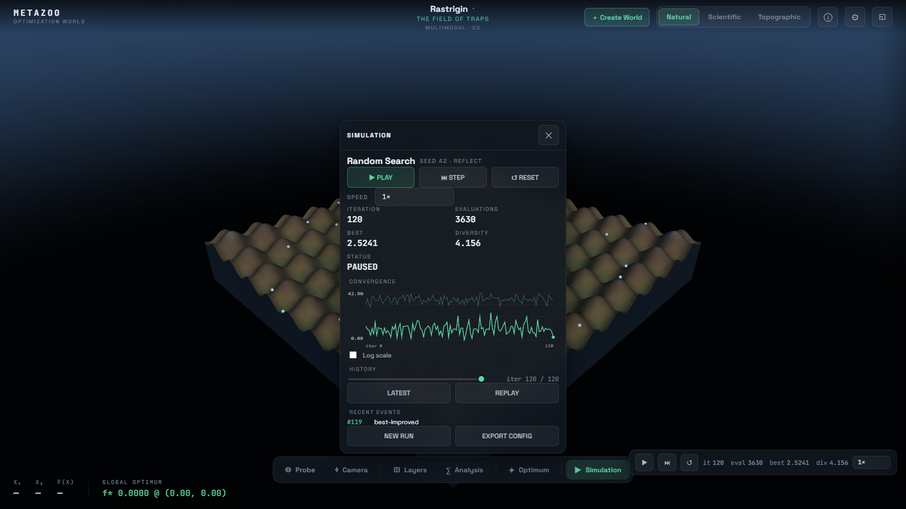
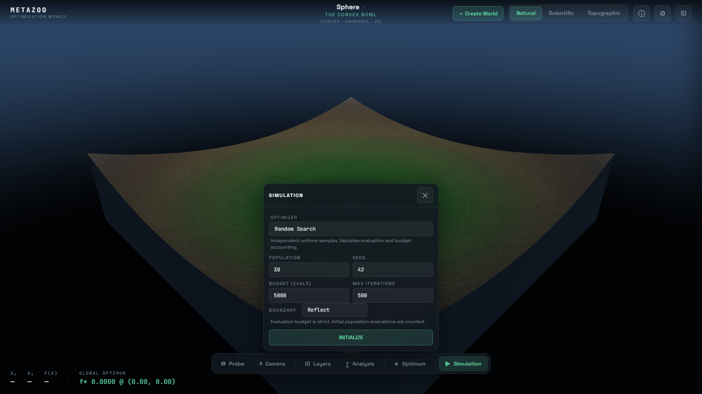
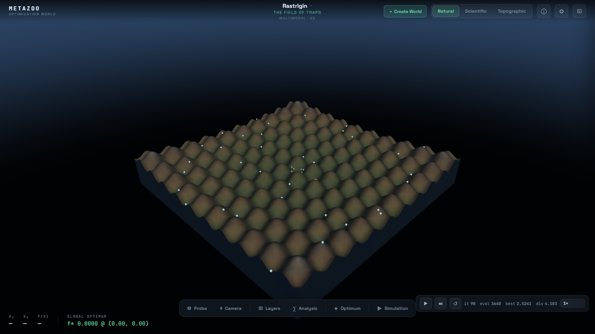
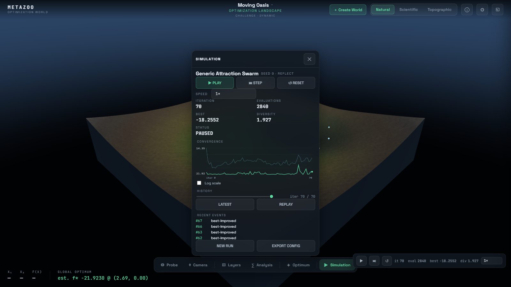

# METAZOO

METAZOO is an interactive 3D optimization world. A cost function becomes a
terrain: valleys are good solutions, peaks are bad ones. You can explore
benchmark functions, write custom objectives, sculpt worlds, build challenges
with noise/constraints/dynamics, and — since Phase 2 — run generic optimization
agents and watch them search the landscape.



## Ringkasan (Bahasa Indonesia)

METAZOO mengubah fungsi optimasi menjadi dunia 3D yang bisa dijelajahi. Phase 2
menambahkan mesin simulasi deterministik: pilih optimizer, atur seed/populasi/
budget, lalu lihat agent generik bergerak di permukaan terrain sambil merekam
telemetri, riwayat, dan convergence chart. Repo ini berisi Phase 1/1.5 (dunia,
custom function, sculpt, challenge) dan Phase 2 (simulation engine + generic
optimization-agent framework).

## Features

- **Optimization worlds** — benchmark functions rendered as interactive terrain.
- **Custom functions** — expression-based objectives with preview.
- **Sculpt mode** — paint basins and shape your own landscape.
- **Challenges** — noise, constraints, synthetic basins, moving optima.
- **Simulation engine** — deterministic logical clock, strict evaluation budget,
  seeded RNG, history, replay, telemetry and stale-world safety.
- **Generic optimizers** — random search, gradient descent, and an engine-test
  attraction swarm.
- **Generic agents** — instanced scientific markers, best marker, trails,
  click-to-inspect.
- **Scientific views** — natural, scientific, topographic, contours, gradients,
  basins, critical points, cross-sections and probing.

## Tech Stack

- TypeScript + Vite
- Three.js
- Vitest
- ESLint

## Quick Start

Requirements: Node.js 20 or newer, npm.

```bash
npm install
npm run dev
```

Open http://localhost:3000.

```bash
npm test          # run the test suite
npm run build     # typecheck + production build into dist/
npm run preview   # preview the production build
npm run lint      # eslint
```

## Run on GitHub

### Option 1 — GitHub Codespaces (interactive dev server)

1. Open the repository on GitHub.
2. Click **Code → Codespaces → Create codespace on main**.
3. The devcontainer installs dependencies and starts `npm run dev`.
4. Open the forwarded **port 3000** preview when prompted.

The devcontainer is defined in `.devcontainer/devcontainer.json`.

### Option 2 — GitHub Pages (static build)

The workflow in `.github/workflows/deploy.yml` builds the app and deploys
`dist/` to GitHub Pages on every push to `main`.

One-time setup:

1. Open **Settings → Pages**.
2. Under **Build and deployment → Source**, choose **GitHub Actions**.
3. Push to `main` (or run the workflow manually from the Actions tab).

The site will be available at:

```
https://iwanconysetiadi.github.io/MetaZoo/
```

`vite.config.ts` automatically uses `/<repo>/` as the base path when building
inside GitHub Actions, so assets resolve correctly on project Pages.

### Option 3 — Run locally

```bash
git clone https://github.com/iwanconysetiadi/MetaZoo.git
cd MetaZoo
npm install
npm run dev
```

## Collaborating

The repository is public, so anyone can fork it and open a pull request.
To give someone direct write access, invite them under
**Settings → Collaborators** (or send their GitHub username).

## Using the Simulation

1. Click **Simulation** in the bottom dock.
2. Choose an optimizer, seed, population size, evaluation budget, iteration cap
   and boundary policy.
3. Press **INITIALIZE**, then **PLAY** or **STEP**.
4. Use the control strip/metrics, convergence chart, scrubber, replay and
   candidate inspector while the run progresses.

Optimizers included:

| ID | Description |
| --- | --- |
| `random-search` | Population-based reference optimizer |
| `gradient-descent` | Single-agent reference optimizer |
| `test-swarm` | Generic attraction swarm (engine test only) |

## Controls

| Input | Action |
| --- | --- |
| Left drag | Orbit |
| Right drag | Orbit |
| Middle drag / Shift + right drag | Pan |
| Wheel | Zoom |
| `1` / `2` / `3` | Natural / Scientific / Topographic view |
| `o` | Overview camera |
| `f` | Focus global optimum |
| `c` / `g` / `b` / `m` | Toggle contours / gradient / basins / minima |
| `r` | Rebuild world |
| `Space` / `p` | Presentation mode |
| Click agent | Inspect candidate (when a simulation is active) |

## Architecture

```
OptimizationWorld
      ↓
EvaluationService   (only approved objective path, budgeted + counted)
      ↓
Optimizer           (random-search | gradient-descent | test-swarm)
      ↓
SimulationEngine    (logical clock, validation, history, telemetry, stale checks)
      ↓
OptimizerState / RenderFrame
      ↓
GenericAgentRenderer (InstancedMesh + best marker + trails)
      ↓
Three.js scene
```

The optimizer and logical clock never depend on render FPS. Playback speed only
changes pacing; with the same seed and configuration the logical steps are
identical.

## Project Structure

```
src/
  core/
    simulation/       # engine, clock, history, telemetry, optimizers
    world/            # OptimizationWorld + samplers
    benchmarks/       # benchmark functions
    custom/           # challenge/objective composition
    sculpt/           # sculpted worlds
  rendering/          # terrain, overlays, agents
  interaction/        # probe, measurement, cross-section, markers
  ui/                 # app UI and simulation UI
  main.ts
tests/                # Vitest suites
screenshots/          # Phase 1/1.5 + Phase 2 screenshots
```

## Testing

```bash
npm test
```

The suite covers benchmark functions, world sampling, custom/sculpted worlds,
critical points, simulation determinism, reset reproducibility, evaluation
budgets, boundary policies, history scrubbing, completion states, dynamic worlds,
and stale-world recovery.

## Screenshots

| Phase 2 | |
| --- | --- |
|  |  |
|  |  |

See `screenshots/` for the full set and `PHASE2_REPORT.md` for the Phase 2
implementation report.

## Known Limitations

- Only reference optimizers are implemented; the full algorithm zoo and race mode
  are out of scope.
- Gradient/Hessian sampling is not counted as an objective evaluation; only
  `EvaluationService` calls consume budget.
- Agent trails keep the last 9 logical positions.
- Dynamic terrain rebuilds are throttled for performance; logical time remains
  exact.
- Desktop-first UI.

## Documentation

- [Phase 2 report](PHASE2_REPORT.md)
